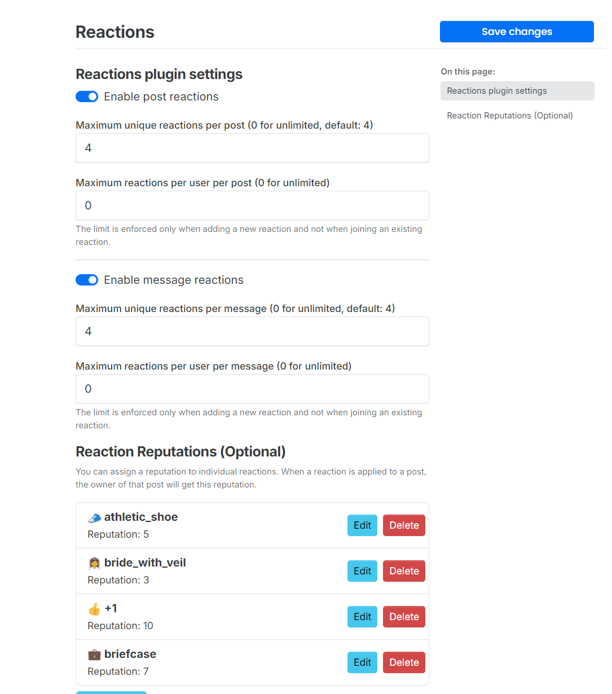

# nodebb-plugin-reactions
Reactions plugin for NodeBB

This plugin requires nodebb-plugin-emoji to be active.

# Installation
Install via one-click activation in the Admin Control Panel or run the following command:

    npm i git+https://github.com/ClickAndGoScript/nodebb-plugin-reactions

# Behavior

- Post authors can't react to their own posts (can be allowed in the ACP: "Allow users to react to their own posts"). Reacting to your own post never gives reaction reputation.
- Hover (desktop) or long-press (touch devices) on a reaction shows who reacted. On touch devices the popup stays open until you tap somewhere else.
- Right-click (desktop) on a reaction, or "Show everyone" in the touch popup, opens the full list of users.
- Several users reacting with the same emoji to the same post or chat message are merged into a single notification. Different emojis on the same post keep separate notifications.
- Built-in forum upvote ("like"): when it is removed, the author's notification is deleted too. The switch is in the forum settings, tab "Reputation & Flags" (Settings > Reputation & Flags): "Delete the notification when the forum's built-in upvote is removed"; on by default.
- Reaction notifications show the emoji as an image (not the `:name:` text).
- When a user removes their reaction, the notification that was sent to the author for it is deleted. Controlled by the ACP switch "Delete the notification when the reaction is removed" (block "Notifications", applies to posts and chats; on by default).
- A notification that the author has already read is never deleted, neither for removed reactions nor for removed upvotes.

# Emojis in Topic Titles and Notifications

In the admin settings of nodebb-plugin-emoji, turn on "Parse emojis in topic titles" to see emojis as images in topic titles and notifications.

# Screenshots

## Reactions:

## ACP:

